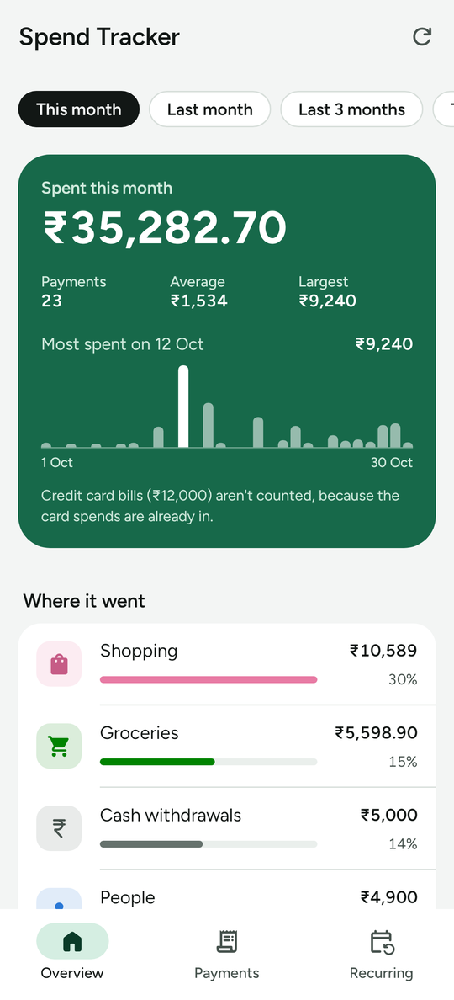
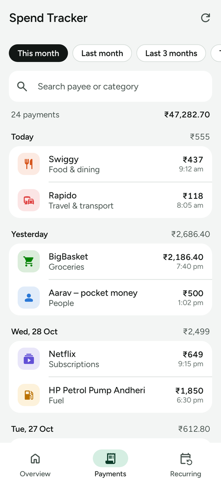
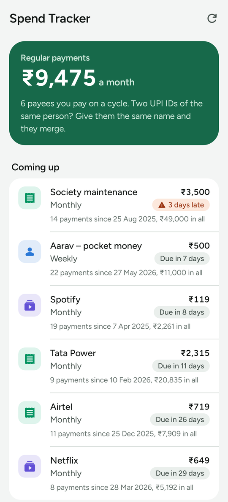
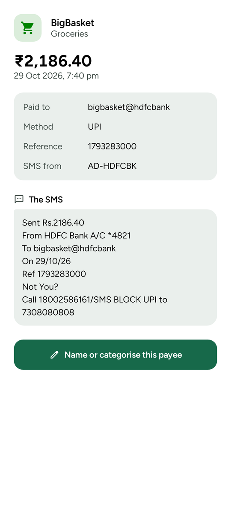
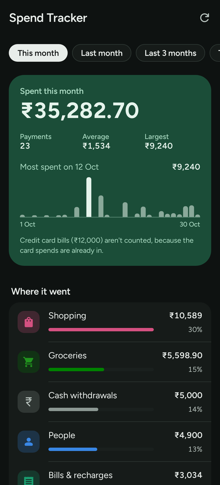

# Spend Tracker

An Android app that reads your bank, UPI and wallet SMS and shows where your money goes.
Everything stays on the phone: the app's only permission is `READ_SMS` (no internet).

## [⬇ Download Spend Tracker (APK)](https://github.com/maulik0jain/spend-tracker/releases/latest/download/SpendTracker.apk)

Android 8.0 or newer. All versions are on the [Releases](https://github.com/maulik0jain/spend-tracker/releases) page.

<p>
  
  
  
</p>
<p>
  
  
</p>

- **Overview**: total spent for a period (this month, last month, last 3 months, this year,
  all time, or a custom date range), spending by day, week or month (tap a bar for its
  amount), and where it went: by category, top payees and payment size.
- **Payments**: every debit grouped by day, searchable. Tap one to see the original SMS and to
  name or re-categorise the payee (e.g. `son@okaxis` → "Son – pocket money"). The name applies
  to every past and future payment to that payee. Give two payees the same name to merge them.
- **Recurring**: payees you pay on a weekly / monthly / quarterly / yearly cycle, what you
  usually pay, when the next one is due (late ones are flagged), and ones that look cancelled.

Each category has its own colour and icon on every screen. Light and dark mode follow the phone.

Google Pay and PhonePe don't send SMS themselves; the bank's UPI debit SMS covers them.
Formats are written for Indian banks (HDFC, SBI, ICICI, Axis, Kotak, Canara, Bank of Baroda,
Union Bank), Paytm and card issuers.

## Install

1. Open the download link above on your phone and install the APK. Android will ask you to
   allow installs from your browser or file manager the first time.
2. Open Spend Tracker and allow SMS access.
3. If Android won't show the SMS permission prompt (Android 13+ blocks it for apps installed
   from a file): Settings → Apps → Spend Tracker → ⋮ → *Allow restricted settings*, then
   Permissions → SMS → Allow.

Or over USB with developer options on: `adb install -r SpendTracker.apk`.

Updating from 1.0: install 2.0 over it. Your payee names and categories are kept.

## Build

Needs JDK 17 and the Android SDK (platform 35). Point `local.properties` at the SDK
(`sdk.dir=/path/to/android/sdk`) or set `ANDROID_HOME`.

```bash
./gradlew testDebugUnitTest             # parser / recurring-detection / chart tests
./gradlew validateDebugScreenshotTest   # screens against app/src/debug/screenshotTest/reference
./gradlew updateDebugScreenshotTest     # re-render those reference images after a UI change
./gradlew assembleRelease               # -> app/build/outputs/apk/release/app-release.apk
```

The screenshots render the previews in `app/src/screenshotTest` on the computer, no phone needed.

## Code map

| Path | What it does |
|---|---|
| `parse/TransactionParser.kt` | SMS → debit transaction (amount, payee, method, reference); ignores credits, OTPs, reminders, failures |
| `parse/Categorizer.kt` | payee → category (known merchants, people vs shops) |
| `analysis/RecurringDetector.kt` | finds regular payees |
| `analysis/Summary.kt` | periods, totals, amount buckets, spending over time |
| `data/SmsSource.kt` | reads the SMS inbox |
| `data/PayeeTags.kt` | your own payee names and categories |
| `ui/Theme.kt` | colours, type, and each category's colour and icon |
| `ui/` | Compose screens |

If a bank's SMS isn't picked up, add a sample of it to `TransactionParserTest` and adjust the
patterns in `TransactionParser`.

## Credits

- [Figtree](https://github.com/erikdkennedy/figtree) typeface, SIL Open Font License 1.1 (`app/src/main/assets/licenses/figtree-OFL.txt`).
- [Material Symbols](https://github.com/google/material-design-icons) icons, Apache License 2.0.
